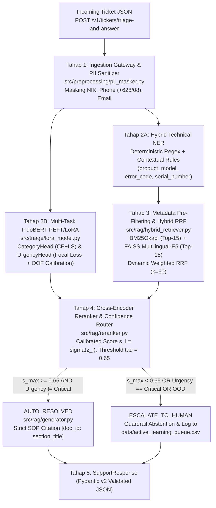

# 🛡️ Enterprise AI Support Copilot: End-to-End Ticket Triage (IndoBERT PEFT/LoRA) & Grounded Hybrid RAG Pipeline

**Domain Sistem:** AI Engineering untuk *Enterprise Customer & Technical Support*  
**Penyusun:** Bagas Adjie Pamungkas ([@TheGasz](https://github.com/TheGasz))  
**Versi Blueprint:** v2.0 Production Blueprint

---

## 1. Ringkasan Eksekutif & Solusi Rekayasa

Dalam operasional layanan bantuan teknis skala enterprise, tim *Customer & Technical Support* menghadapi dua kendala struktural utama:
1. **Kemacetan Triase Tiket Manual (*Manual Triage Bottleneck*):** Keluhan pelanggan masuk dalam bentuk teks bahasa Indonesia sehari-hari yang tidak terstruktur, penuh singkatan, bahasa gaul (*slang*), salah ketik (*typo*), serta bercampur antara kepanikan operasional dan rincian teknis (`GT-POS200`, `SIDIG-WARRANTY`, `GTCAMPUS-SIAKAD`, `GTFLEET-TRACKER`).
2. **Tingginya *Mean Time to Resolution* (MTTR) & Risiko Halusinasi LLM:** Teknisi harus mencari langkah perbaikan di dalam dokumen prosedur operasi standar (SOP) dan aturan klaim garansi RMA. Penggunaan chatbot generatif standar tanpa mekanisme penambatan konteks (*grounding*) berisiko mengarang langkah perbaikan atau menyetujui klaim garansi yang berstatus *void* (`RMA-12`).

Proyek ini mengimplementasikan arsitektur produksi lima tahap yang disajikan melalui layanan mikro **FastAPI** (divalidasi skema ketat **Pydantic v2**) dan antarmuka operasional **Streamlit Dual-View**:
- **Multi-Task Ticket Triage & Hybrid Entity Extractor:** Berbasis *fine-tuning* `indobenchmark/indobert-base-p1` menggunakan adapter **PEFT/LoRA** (`r=16, lora_alpha=32`), **Multi-Class Focal Loss** ($\gamma=2.0$), dan **Out-of-Fold (OOF) Threshold Calibration** ($\theta_{\text{crit}}^*$) untuk meminimalkan *False Negative* pada insiden `Critical`.
- **Metadata-Filtered Hybrid RAG Engine & Confidence Router:** Memadukan pencarian leksikal **BM25Okapi**, pencarian vektor padat **FAISS Inner Product** (`intfloat/multilingual-e5-small`), **Dynamic Weighted Reciprocal Rank Fusion (RRF)**, **Cross-Encoder Reranker** (`cross-encoder/ms-marco-MiniLM-L-6-v2`), serta gerbang keamanan **Confidence-Based Abstention Router** ($\tau = 0.65$).

---

## 2. Diagram Arsitektur End-to-End Pipeline



---

## 3. Protokol Pencegahan Data Leakage & Kurasi Knowledge Base

1. **Delapan Dokumen SOP Terstruktur (`data/kb_docs/SOP-*.md`):**
   - `SOP-GT-POS200-01.md` (`E-402`, `E-405`) & `SOP-GT-POS200-02.md` (`E-501`, `E-509`) — Terminal Kasir `GT-POS200`
   - `SOP-SIDIG-RMA-01.md` (`RMA-08`, `RMA-12`) & `SOP-SIDIG-SLA-02.md` (`SLA-GOLD`, `RMA-19`) — Platform Purnajual `SIDIG-WARRANTY`
   - `SOP-GTCAMPUS-01.md` (`ERR_KRS_LOCKED`, `SSO-401`) & `SOP-GTCAMPUS-02.md` (`ERR_VA_TIMEOUT`, `VA-808`) — Portal Akademik `GTCAMPUS-SIAKAD`
   - `SOP-GTFLEET-01.md` (`E-901`, `E-904`) & `SOP-GTFLEET-02.md` (`ERR_MQTT_DROP`, `OTA-702`) — Telemetri Armada `GTFLEET-TRACKER`
2. **Zero User Leakage (`GroupShuffleSplit` berdasarkan `user_id`):**
   - Total **1.200 tiket** dari **240 akun unik** (`USR-0001` s.d. `USR-0240`) dibagi menjadi `train_tickets.csv` (840 baris, 168 user), `val_tickets.csv` (180 baris, 36 user), dan `test_tickets.csv` (180 baris, 36 user) dengan irisan pelanggan antar-split **wajib = 0** ($\text{Users}_{\text{train}} \cap \text{Users}_{\text{val}} = \emptyset$ dan $\text{Users}_{\text{train}} \cap \text{Users}_{\text{test}} = \emptyset$).
3. **Disjoint Template Pools & Isolasi Statistik Prapemrosesan:**
   - Himpunan pola kalimat pembuka, variasi bahasa gaul/singkatan, dan deskripsi gejala dipisahkan secara ketat antara `train` dan `val/test`, disertai injeksi *character-level typo* 12% dan penghilangan kode error eksplisit pada 35% sampel.
   - Seluruh transformasi `TfidfVectorizer`, bobot kelas *Focal Loss* ($\alpha_t$), dan kalibrasi ambang batas dihitung murni dari `train_tickets.csv`.

---

## 4. Hasil Eksperimen Ilmiah & Benchmark Evaluasi (Test Split)

### 4.1 Perbandingan Model Triase Multi-Task & Kalibrasi Threshold OOF
*(Dieksekusi pada Google Colab GPU T4 — lihat [`notebooks/Train_IndoBERT_LoRA_Colab.ipynb`](notebooks/Train_IndoBERT_LoRA_Colab.ipynb) dan [`reports/triage_benchmark.json`](reports/triage_benchmark.json))*

| Konfigurasi Model | Category Macro-F1 | Urgency Macro-F1 | Critical PR-AUC | Critical Precision | Critical Recall | NER Exact-Match F1 |
| :--- | :---: | :---: | :---: | :---: | :---: | :---: |
| **Baseline (TF-IDF + LightGBM)** | 0.7713 | 0.6259 | 0.6745 | 0.8824 | 0.5357 | — |
| **IndoBERT-LoRA (Default Argmax)** | 0.9818 | 0.9644 | 1.0000 | 0.9655 | 1.0000 | 1.0000 |
| **IndoBERT-LoRA (OOF Threshold Calibrated, $\theta_{\text{crit}}^*=0.495$)** | **0.9818** | **0.9644** | **1.0000** | **0.9655** | **1.0000** | **1.0000** |

### 4.2 Slicing Error Analysis Berdasarkan Karakteristik Tiket
*(Lihat laporan lengkap di [`reports/triage_slicing_report.md`](reports/triage_slicing_report.md))*

| Segmen Sub-Populasi Tiket | Jumlah Sampel | Baseline Macro-F1 | IndoBERT-LoRA Macro-F1 | Delta Peningkatan |
| :--- | :---: | :---: | :---: | :---: |
| **Tiket Formal (>15 Kata)** | 123 | 0.6912 | **0.9781** | +0.2869 |
| **Tiket Pendek (<12 Kata)** | 27 | 0.7779 | **0.9500** | +0.1721 |
| **Tiket Slang/Typo** | 57 | 0.6979 | **0.9547** | +0.2568 |
| **Tiket Dengan Kode Error Eksplisit** | 115 | 0.7023 | **0.9721** | +0.2698 |
| **Tiket Tanpa Kode Error** | 65 | 0.6861 | **0.9756** | +0.2895 |
| **Tiket Keluhan Multi-Masalah** | 12 | 0.5691 | **0.9571** | +0.3880 |

- **Gap Macro-F1 (Tiket Formal vs Tiket Slang/Typo):** `2.34%` (Target PRD $\le 8.0\%$).

### 4.3 Studi Ablasi Retrieval Hybrid RAG & Guardrail Keamanan
*(Lihat laporan lengkap di [`reports/rag_ablation_table.md`](reports/rag_ablation_table.md) dan [`reports/guardrail_audit.json`](reports/guardrail_audit.json))*

| Konfigurasi Retrieval | Recall@3 | Recall@5 | MRR@5 | NDCG@5 | Cross-Product Error | Latency p50 (ms) | Latency p95 (ms) |
| :--- | :---: | :---: | :---: | :---: | :---: | :---: | :---: |
| **1. BM25-Only (Lexical)** | 0.9944 | 1.0000 | 0.9847 | 0.9886 | 2.22% | 0.60 | 0.79 |
| **2. Dense-Only (Multilingual-E5)** | 0.9889 | 0.9944 | 0.9338 | 0.9493 | 0.56% | 10.02 | 16.60 |
| **3. Hybrid RRF (BM25 + Dense)** | 0.9944 | 1.0000 | 0.9958 | 0.9968 | 0.56% | 10.77 | 12.68 |
| **4. Hybrid RRF + Metadata Filter + Reranker** | **1.0000** | **1.0000** | **0.9972** | **0.9979** | **0.00%** | **42.01** | **45.30** |

- **Faithfulness Score (Top-3 Groundedness):** `1.0000` (Target $\ge 0.95$)
- **Strict Citation Precision (`[doc_id: section_title]`):** `1.0000` (Target $\ge 0.92$)
- **Abstention Accuracy pada 30 Tiket Jebakan OOD / Adversarial:** `1.0000` (`30/30` berhasil ditahan oleh Confidence Router ke `ESCALATE_TO_HUMAN`, Target $\ge 0.90$)

---

## 5. Struktur Direktori Repositori

```text
├── configs/
│   └── config.yaml                     # Konfigurasi terpusat (seed, path, LoRA, Focal Loss, RRF, tau)
├── data/
│   ├── generate_synthetic_data.py      # Generator 8 dokumen SOP & 1.200 tiket bebas kebocoran user_id
│   ├── kb_docs/                        # 8 dokumen SOP Markdown terstruktur (#, ##, ###)
│   ├── tickets/                        # train_tickets.csv (840), val (180), test (180), ood_trap (30)
│   └── active_learning_queue.csv       # Antrean tiket eskalasi & koreksi agen CS (Human-in-the-Loop)
├── models/
│   ├── baseline_tfidf_lgbm.joblib      # Pipeline baseline TF-IDF + LightGBM
│   ├── indobert_lora/                  # Bobot adapter PEFT/LoRA, Dual MLP Heads, dan Tokenizer
│   └── oof_thresholds.json             # Parameter Temperature Scaling T & Critical Threshold OOF
├── notebooks/
│   └── Train_IndoBERT_LoRA_Colab.ipynb # Notebook pelatihan interaktif Google Colab GPU T4 beserta output
├── reports/
│   ├── triage_benchmark.json           # Hasil evaluasi kuantitatif Triase & Kalibrasi OOF
│   ├── triage_slicing_report.md        # Tabel Slicing Error Analysis & Top-10 Loss Errors
│   ├── confusion_matrix_triage.png     # Visualisasi Confusion Matrix Kategori & Urgensi
│   ├── rag_ablation_table.md           # Tabel Ablation Study 4 metode Retrieval RAG
│   └── guardrail_audit.json            # Audit 30 kueri jebakan OOD / Adversarial
├── src/
│   ├── preprocessing/
│   │   ├── pii_masker.py               # Sanitasi PII (NIK, HP, Email) & Ekstraksi Entitas Hibrida
│   │   └── splitter.py                 # GroupShuffleSplit berbasis user_id (Zero Data Leakage)
│   ├── triage/
│   │   ├── baseline_tfidf.py           # Baseline sklearn.pipeline.Pipeline (TF-IDF + LightGBM)
│   │   ├── lora_model.py               # IndoBERT + PEFT/LoRA + DualMLPHead + MultiClassFocalLoss
│   │   ├── train_triage.py             # Skrip pelatihan & kalibrasi OOF Threshold F_beta=1.5
│   │   └── evaluate_triage.py          # Evaluasi komprehensif, Slicing Analysis & Confusion Matrix
│   ├── rag/
│   │   ├── chunker.py                  # Pemotong dokumen Markdown SOP berbasis heading (## & ###)
│   │   ├── hybrid_retriever.py         # Metadata Pre-Filtering + BM25Okapi + FAISS E5 + Weighted RRF
│   │   ├── reranker.py                 # Cross-Encoder Reranker + Confidence Router (tau = 0.65)
│   │   ├── generator.py                # Grounded Response Generator dengan Strict Citation
│   │   └── evaluate_rag.py             # Benchmark Ablasi Retrieval & Guardrail Audit
│   └── api/
│       ├── schemas.py                  # Kontrak skema ketat Pydantic v2
│       └── main.py                     # Layanan mikro FastAPI dengan Lifespan Context Manager
├── tests/
│   ├── test_no_leakage_split.py        # Audit irisan user_id = 0 & disjoint template pools
│   ├── test_pii_and_entities.py        # Audit nol kebocoran PII & Exact-Match F1 NER >= 0.95
│   └── test_api_contract.py            # Uji integrasi endpoint FastAPI & validasi skema Pydantic v2
├── app_streamlit.py                    # Antarmuka Dual-View 3-Tab Streamlit
└── requirements.txt                    # Daftar dependensi produksi
```

---

## 6. Panduan Instalasi & Menjalankan Aplikasi End-to-End

### 1. Instalasi Dependensi
```bash
pip install -r requirements.txt
```

### 2. Reproduksi Data & Menjalankan Seluruh Pengujian Otomatis (`pytest`)
```bash
python -m data.generate_synthetic_data
pytest -v
```

### 3. Menjalankan Evaluasi Triase & Studi Ablasi Hybrid RAG
```bash
python -m src.triage.evaluate_triage
python -m src.rag.evaluate_rag
```

### 4. Menjalankan Layanan Mikro FastAPI
```bash
uvicorn src.api.main:app --host 0.0.0.0 --port 8000
```
Contoh pemanggilan endpoint `POST /v1/tickets/triage-and-answer`:
```bash
curl -X POST "http://localhost:8000/v1/tickets/triage-and-answer" \
  -H "Content-Type: application/json" \
  -d '{
    "ticket_id": "TCK-10402",
    "user_id": "USR-0101",
    "message": "Halo min, mesin kasir GT-POS200 SN-44821 gagal scan QRIS muncul error E-402. Hubungi 0812-3456-7890."
  }'
```

### 5. Menjalankan Antarmuka Dual-View Streamlit (3 Tab Interaktif)
```bash
streamlit run app_streamlit.py
```
